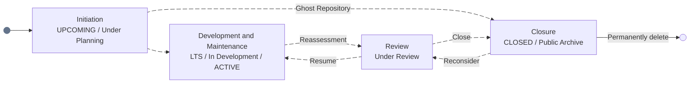

  

## I. Introduction

<table>
<tr>
<td width="60%" align="justify" valign="middle">
Hello everyone, my name is Van Trung Thanh. I am a student at Ho Chi Minh City Open University. My major is information technology, with a focus on software engineering and generative AI (GenAI) engineering. Additionally, I’m interested in training and developing AI models. A little more about me:

- Specialization in software engineering.
- A particular interest in GenAI, DevOps, and automation.
- Experience in software architecture, CI/CD, and cloud computing.
- I burn out quite easily, but I persevere and handle my work quite well.
- Last updated: 2026-10-25 9:00 PM
</td>
<td width="40%" align="center">
  
</td>
</tr>
</table>

## II. Experience

*Note: I estimate my proficiency in the skills listed here at about 80%, based on practical experience. I am still developing my knowledge and understanding.*

### A. Programming Languages

### B. Frameworks and Libraries

### C. DevOps and Automation

### D. Cloud and Hosting Services

### E. Other Tools and Skills

## III. My Repository Tags

> [!NOTE]
>
> Tags: [UPCOMING / Under Planning]
> 
> These are repositories currently under consideration for implementation or in the planning stages of development. These repositories follow one of two paths: they either enter the active development lifecycle or end up on my list of "ghost repositories".

> [!IMPORTANT]
> 
> Tags: [LTS (Long-term support) / In Development / ACTIVE]
>
> These are repositories currently under active development or long-term maintenance. Activities such as Releases/Maintenance/Help Wanted/QA's remain available. These repositories may enter an "Under Review" phase when reassessment is needed.

> [!WARNING]
>
> Tags: [Under Review]
>
> These are repositories currently being reassessed due to concerns about their future development or maintenance. These repositories follow one of two paths: they either return to the active development lifecycle, or end up on the list of closed repositories.

> [!CAUTION]
> 
> Tags: [CLOSED / Public Archive]
> 
> These repositories have been closed almost permanently (unless they are placed into an "Under Review" phase). Activities such as Release/Maintenance/Help Wanted/QA's won't be available.

## IV. Frequently Asked Questions

Which university do I attend?

> I am currently a final-year student in the Faculty of Information Technology at Ho Chi Minh City Open University. I think the teachers are very enthusiastic, and my friends are friendly and helpful. However, I think students have to study independently and work hard. Otherwise, they may fall behind. This is because my university is not one of the top universities for information technology, so students need to be proactive and take responsibility for their own learning.

What fields do my projects cover?

> I focus on software development across the entire software development life cycle (SDLC). My main areas of focus include software solutions, software architecture, and full-stack development for outsourced projects. In addition, I plan to improve my skills in native application development for Windows, Linux, and Android.

How do I approach my work?

> I’ll keep trying until I simply can’t anymore, but I’ve recently started changing my work habits by avoiding excessive overtime and spending more time outdoors on weekends. What do you think? Should we pay more attention to our careers or to our mental and physical health?

What are my values?

> 1. Freedom to develop skills in a healthy work environment.
> 2. Respect and appreciation for everyone's efforts. 
> 3. Mistakes should be corrected, and feedback should be clear and constructive.
> 4. Self-care should be a priority.
> 5. Mistakes should be corrected, not met with insults, swearing, or sarcasm. Sometimes, strong criticism is necessary, but I strongly dislike offensive or personally insulting language.
> 6. It is not fair to dismiss the hard work of the whole team just because one person has contributed more than others.
> 7. At the same time, people who perform well or contribute more should receive proper recognition and rewards. Their efforts should not be overlooked or dismissed.

---

  

  

